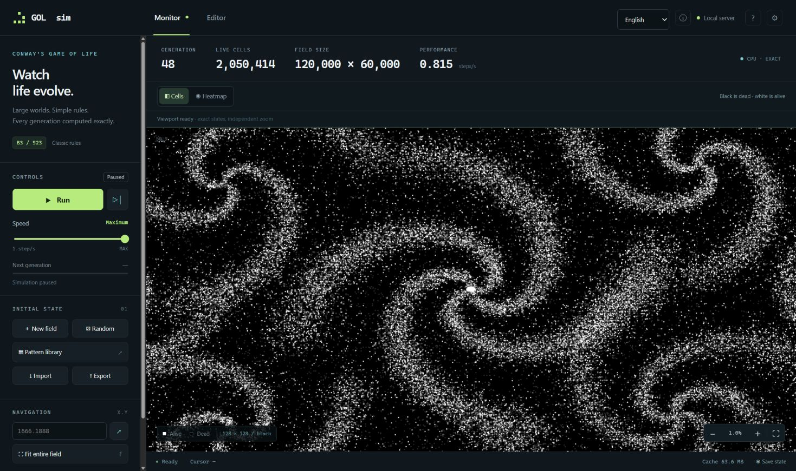
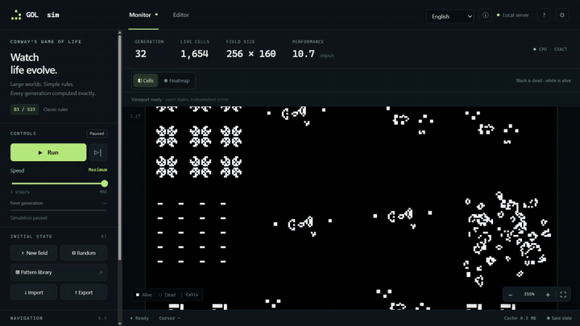
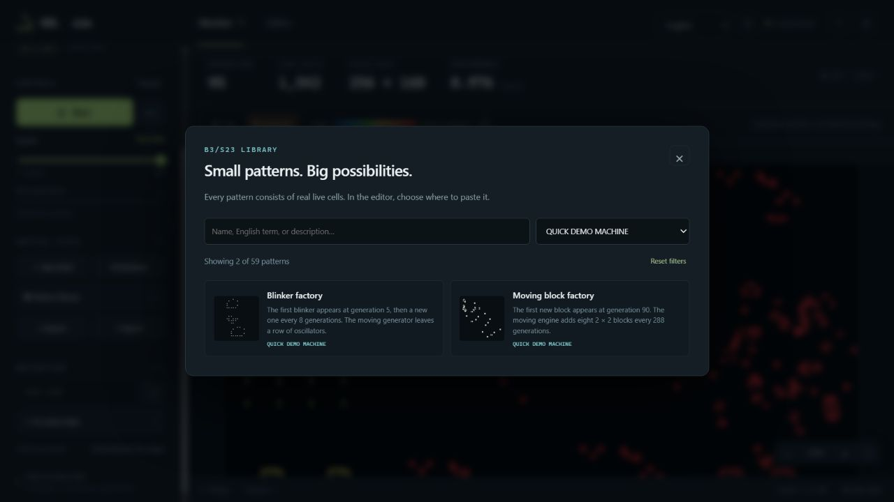
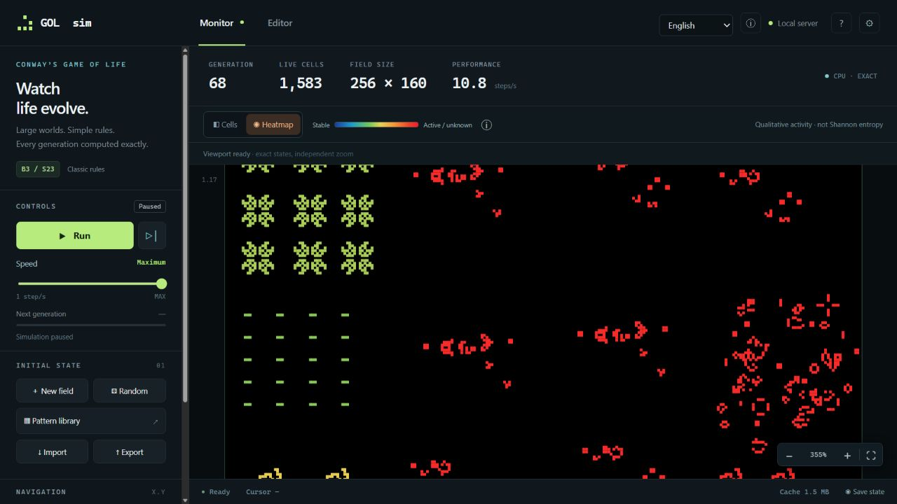

<div align="center">

# GOL sim

**Fast Conway’s Game of Life for large-scale simulations.**

A parallel Rust engine, a Python server, and a browser workspace for watching worlds evolve or building your own.


[](https://github.com/pythhon1c/GOL-sim/actions/workflows/check.yml)
[](LICENSE)

[Quick start](#quick-start) · [Watch the demo](#demo) · [How it stays fast](#how-it-stays-fast) · [Configuration](config.example.toml) · [Architecture](ARCHITECTURE.md)

</div>



*Generation 48 on a 120,000 × 60,000 field with 2,050,414 live cells. The seeds were placed in spiral arms. At this zoom each gray sample shows the population of a 128 × 128 block.*

GOL sim is designed for large sparse worlds, with configurable resource budgets for dense workloads. Empty space costs little; active regions are computed in parallel; repeated local evolution can reuse verified results. **Every generation follows classic B3/S23, with all cells updated simultaneously from the previous state.**

## Explore, simulate, create

| | Live monitor | Standalone editor |
| --- | --- | --- |
| Purpose | Run, pause, step and inspect a simulation | Build and export an initial state |
| Large fields | Parallel native computation; finite or wrapped edges | Sparse storage; viewport rendering |
| Navigation | Pan, cursor-centered zoom, density and thermal views | Pan, cursor-centered zoom and density view |
| Tools | Progress, time estimates, resource and cycle statistics | Paint, erase, lines, rectangles, selections, copy/paste, transforms, undo/redo |
| Patterns | Load a pattern and run supported device demonstrations | Preview and place patterns on the field |
| Files | RLE/JSON import and export; segmented checkpoints | RLE/JSON import and export |
| Requirements | Local Python server and compiled Rust core | Open `web/index.html` directly; no server or build step |

The public library includes **59 ready-to-use patterns**: still lifes, oscillators, spaceships, glider guns, growing patterns and verified logic demonstrations. Search names in English, Russian or Ukrainian. The interface starts in **English** and remembers your language choice.

Black cells are dead and white cells are alive. Zoomed-out gray represents population density. The optional thermal view highlights guarded recurrence and activity using a fixed scale; its colors never change the simulation.

## Demo

Watch a 256 × 160 field evolve. At generation 68, the monitor switches from white cells to a heatmap of the same population. The recording then opens the pattern library, browses factories, logic circuits and glider guns, and runs the Gosper gun long enough to see two gliders in flight.

[](https://github.com/pythhon1c/GOL-sim/raw/refs/heads/keys.land/docs/media/simulation.mp4)

[Download the 25-second video in 720p (MP4)](https://github.com/pythhon1c/GOL-sim/raw/refs/heads/keys.land/docs/media/simulation.mp4)

| Ready-made machines | Heatmap at generation 68 |
| --- | --- |
|  |  |
| The Blinker factory leaves a trail of oscillators. The Moving block factory leaves stationary blocks. | Cooler colors mark confirmed cycles. Dense activity in regions without a confirmed cycle appears red. |

Pattern credits and redistribution terms are listed in [Third-party notices](THIRD_PARTY.md).

## Quick start

### Windows

Install **Python 3.11+**. Setup uses an existing **Rust stable** toolchain or installs one locally when needed. Internet access is required for initial dependency installation.

From the project folder, run:

```powershell
.\setup.ps1
.\start.ps1
```

Open **[localhost:8765](http://127.0.0.1:8765/)**. The simulation starts paused.

1. Create a field or choose a pattern from the library.
2. Start the simulation, or advance one generation at a time.
3. Zoom out to inspect large regions; open **Additional information** for engine statistics.

Setup creates a virtual environment and copies `config.example.toml` to `config.toml` without overwriting existing settings. If Python is not on `PATH`, use `setup.ps1 -PythonPath C:\path\to\python.exe`.

**Editor only:** open [`web/index.html`](web/index.html) directly in your browser. Painting, local pattern assets and file operations work offline. Simulation controls require the server.

## How it stays fast

| Mechanism | What it saves | What keeps it exact |
| --- | --- | --- |
| **Sparse, bit-packed tiles** | Empty regions need no full-grid allocation; integer bit planes evaluate 64 cells per word | Exact binary states and all eight neighbors |
| **Parallel tile computation** | Rayon distributes independent tile work across CPU threads | Every task reads the preceding generation; results commit together |
| **Bounded transition cache** | Repeated local inputs reuse an already computed output | Full state and boundary comparisons verify each match |
| **Guarded cycle replay** | Stable and recurring regions can reuse stored phases | A changed neighbor invalidates reuse and resumes ordinary calculation |
| **Viewport rendering and cached detail levels** | The browser receives a screen-sized view instead of the entire world | Aggregate populations remain exact; display settings affect only color |

The engine uses **one computational tile level**. Multiple levels of detail belong to visualization. Cache and cycle shortcuts reuse verified transitions one generation at a time; they do not skip unchecked interactions.

Performance depends on hardware, population density, activity and how much evolution can be reused. A **100,000 × 100,000** field has **10 billion positions**; a sparse world and a densely randomized world of those dimensions have very different memory requirements.

Read the [architecture](ARCHITECTURE.md) and [native engine notes](native/README.md) for the data layout, boundary guards and memory accounting.

## Configure your world

Use the visual settings editor or edit `config.toml`. The commented [configuration example](config.example.toml) documents every supported option.

- **World:** dimensions, dead exterior or toroidal wrapping, initial-state file and random rectangular regions.
- **Resources:** automatic or explicit tile size, CPU threads, memory and cache budgets, plus generation-rate pacing.
- **Cycle helpers:** delayed start, detection interval, maximum period and a separate memory budget.
- **Checkpoints:** generation cadence, minimum write interval, segment size, disk quota and write rate.
- **Display:** density contrast, detail-level cache and thermal activity coefficients.

User coordinates are one-based `column.row`: **`1666.1888`** means column 1666, row 1888. Computation API coordinates are zero-based.

Random initialization is reproducible from a full **64-bit seed**, independent of tile size, chunk order and worker count. The selected density is a Bernoulli probability, not an exact population quota. For large worlds, start with a smaller random rectangle and let the monitor route initialization to the server.

### Current limits

Computation is **CPU-only** on one computer. GPU and distributed execution are not implemented. Fields are finite, and usable capacity depends on memory and activity. The native memory budget is an allocation estimate, not a hard operating-system RSS limit; Python, checkpoints and the browser need additional headroom.

CPU ceilings use pacing. Minimum utilization and disk-percentage targets are advisory; checkpoint byte-rate settings control actual writer pacing. The thermal view is a qualitative recurrence/activity metric, not a measurement of physical or Shannon entropy.

<details>
<summary><strong>Checkpoints, background operation and remote access</strong></summary>

Checkpoints are segmented and checksummed. Defaults combine a generation threshold with a **30-minute minimum interval**, a disk quota and write pacing. `coalesce` skips intermediate save opportunities; `strict` pauses at the threshold until saving is permitted.

Use `start-background.ps1` to run in the background and `stop.ps1` to stop that process. Save a checkpoint before stopping to retain the world. On Windows, stop the server before rebuilding its loaded native DLL.

The server binds to loopback by default. External binding requires `LIFE_ACCESS_TOKEN`; use a TLS reverse proxy or VPN for protected remote transport. See [SECURITY.md](SECURITY.md).

Run this distribution from a checkout: a Python wheel alone does not include the browser assets or compiled native core.

</details>

## Correctness and development

```powershell
.\check.ps1
```

The suite runs independent scalar-reference checks for the Rust engine, Python/API tests and offline JavaScript tests. It covers synchronous B3/S23, finite and wrapped boundaries, cross-tile interaction, randomization, cache invalidation, checkpoints, logic demonstrations, catalog data and localization. **Node.js 22+** is required for the JavaScript tests. GitHub Actions runs validation on Windows.

| Reference | Contents |
| --- | --- |
| [Architecture](ARCHITECTURE.md) | State ownership, parallel execution, reuse and rendering |
| [Native engine](native/README.md) | Rust core, C ABI, resource accounting and verification |
| [Configuration example](config.example.toml) | All settings with explanations |
| [Contributing](CONTRIBUTING.md) | Development and contribution guidance |
| [Security](SECURITY.md) | Deployment and vulnerability reporting |
| [Third-party notices](THIRD_PARTY.md) | Pattern provenance, attribution and licenses |

<details>
<summary><strong>Preparing a public source tree</strong></summary>

```powershell
.\.venv\Scripts\python.exe tools/prepare_publication.py
```

The exporter creates `dist/public` from an explicit allowlist. It leaves the working simulation unchanged and does not upload anything. Local configuration, logs, checkpoints, toolchains and patterns with unestablished redistribution terms are excluded. The public catalog contains 59 entries; a local research installation may contain additional imported patterns.

Use `tools/prepare_publication.py --check` to audit the allowlisted source. The output includes a SHA-256 manifest and privacy report. Publish this prepared tree rather than copying the working directory. See [PUBLICATION.md](PUBLICATION.md).

</details>

## License and contact

Copyright © 2026 **pythhon1c**. Original code and documentation use **[PolyForm Noncommercial 1.0.0](LICENSE)**, permitting noncommercial and qualifying educational use. This is source-available software with a noncommercial restriction. **Commercial use requires a separate written license.**

Contact: **[ggggggdev@gmail.com](mailto:ggggggdev@gmail.com)**

Third-party data and dependencies retain their own licenses; see [NOTICE](NOTICE) and [THIRD_PARTY.md](THIRD_PARTY.md). Life Lexicon-derived data and adaptations remain **CC BY-SA 3.0**.
